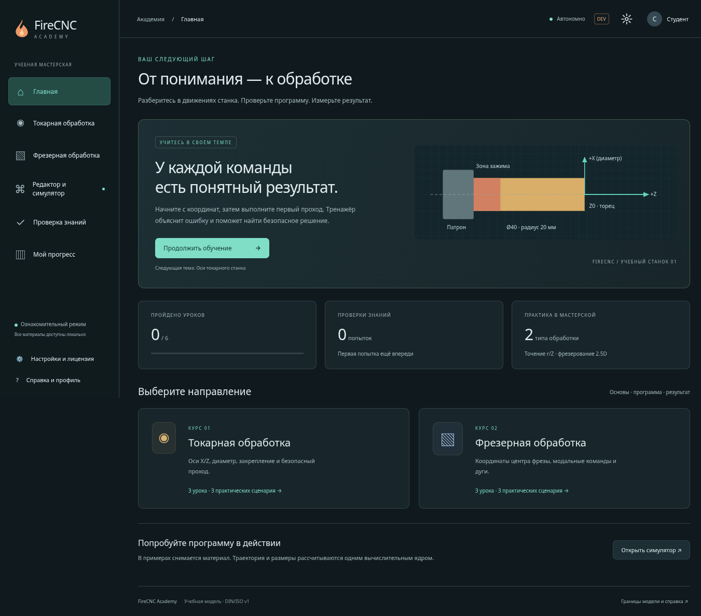

# FireCNC Academy



[Скачать для Windows и Linux](https://github.com/Hunt3rSmile/firecnc-academy/releases/latest) · [Как работают обновления](UPDATING_RU.md)

Автономное настольное приложение для изучения ЧПУ на русском языке. Electron + React + TypeScript; вычислительное ядро работает отдельно от интерфейса. Собственный учебный DIN/ISO, без управления реальным оборудованием.

**Рабочая версия 0.3.0; полный объём A–F ещё проходит приёмку.** Есть 24 собственных урока, 120 разных вопросов, 20 практических заданий с независимой оценкой полной геометрии, G90/G91 по точкам, измерительные приборы, воспроизводимые экзамены с таймером/разбором/PDF, интерактивная наладка и вращение заготовки/фрезы. Офлайн-лицензии, режим преподавателя, учебные пакеты, отдельный сервер коротких ключей, CAD/CAM четырёх операций и мастер восстановления БД работают. Ограничения и оставшаяся приёмка — [STATUS.md](STATUS.md). Последний опубликованный релиз может отставать от рабочей ветки.

## Быстрый старт разработчика

Нужен Node.js 22.12+ (для CI выбран 24 LTS), npm и инструменты сборки C++ для SQLite при отсутствии подходящего готового бинарного модуля. В Linux нужен рабочий графический сеанс; модульные тесты обходятся без дисплея.

```sh
npm ci
npm run dev
```

`dev` собирает локальные assets через Vite и открывает Electron. После изменения исходников перезапустите команду. Это запуск собранного приложения, без зависимости от dev-сервера и CDN. В демо доступны первый урок, вводная проверка и два исходных неизменяемых примера. Редактирование текста доступно; выполнение собственного кода и сохранение нового проекта требуют модуля turning/milling.

```sh
npm run typecheck
npm test
npm run test:e2e
npm run build
npm start
npm run benchmark
npm run benchmark:desktop -- --packaged --cycles 60 --warmup 20
```

Последняя команда требует предварительно созданный Linux runtime (`npm run pack:linux`). Она измеряет повторное открытие/расчёт/закрытие проектов в настоящем Electron. Результаты одной машины не обещают такую же скорость на всех ПК.

E2E сам создаёт временную development-пару в `.local`, собирает клиент с её публичным ключом и запускает настоящие процессы Electron через Playwright. Тестовые данные находятся в отдельных временных каталогах. Приватные ключи не включаются в клиент. `build` встраивает открытый ключ из `config/trusted-keys.json`. Development-лицензии из `.local` в release не принимаются. Закрытые ключи и реальные лицензии не публикуются.

## Локальная активация для разработки

```sh
npm run license:dev
npm run dev
```

В приложении: «Настройки и лицензия» → «Импорт .fcnclic…» → `.local/development.fcnclic`. Откроются пользовательские программы, уроки и все семь модулей development-лицензии, включая CAD/CAM. Development-сборка явно помечена DEV. В ней нет обхода проверки подписи.

Для собственной рабочей пары:

```sh
npm run license:keygen -- --out ./private-keys
npm run license:issue -- --private-key ./private-keys/issuer-private.pem --edition teacher --modules theory,turning,milling,measurements,exams,teacher --days 365 --customer "Учебная группа" --output ./issued/teacher.fcnclic
npm run license:verify -- --license ./issued/teacher.fcnclic --public-key ./private-keys/issuer-public.pem
```

Клиент должен быть собран именно с этим **открытым** ключом:

```sh
npm run build -- --trust ./private-keys/trusted-keys.json
npm start
```

После этого импортируйте `issued/teacher.fcnclic`. Для CAD/CAM добавьте `cadcam` в список `--modules`; по умолчанию Teacher содержит шесть остальных модулей. Как использовать зашифрованный PKCS#8, привязку к установке и ротацию — [LICENSING_ADMIN_RU.md](LICENSING_ADMIN_RU.md).

## Упаковка

Для установки готовой Linux-сборки в Omarchy/Arch:

```sh
./bin/install-omarchy
```

Команда создаёт локальный пакет pacman, устанавливает приложение в `/opt/firecnc-academy`, команду `firecnc-academy` и ярлык с иконкой. Затем откройте **Super+Space → FireCNC Academy**. Для сборки пакета отдельно: `./bin/package-omarchy`. Если Linux runtime ещё не создан, требуется сначала `npm ci`. Данные остаются в пользовательском каталоге, вне пакета. Удаление программы: `sudo pacman -R firecnc-academy`; эта команда не удаляет учебные данные.

```sh
npm run pack:linux
npm run pack:win
```

После упаковки проверьте настоящий пакет: `npm run test:pack`, затем `npm run test:wrapper`. В Windows дополнительно `npm run test:installer`. В headless Linux команды запускаются через `xvfb-run -a`. Wrapper-тест запускает сам portable/AppImage с кириллическими путями и проверяет автономную обработку и сохранение после перезапуска; AppImage проверяется через extract-and-run.

Готовый Linux runtime запускается как `./release/linux-unpacked/firecnc-academy`.

Вторая команда предназначена для Windows x64 с инструментами C++; создаёт NSIS и portable в `release/`. Для включения своего доверенного ключа задайте переменную **на машине сборки**:

```powershell
$env:FCNC_TRUST_FILE = ".\private-keys\trusted-keys.json"
npm run pack:win
```

Сертификат подписи Windows не приложен. electron-builder поддерживает `CSC_LINK` и `CSC_KEY_PASSWORD`; храните их в секретах владельца/CI. Без них файлы неподписанные. GitHub Actions собирает обе платформы, проверяет запуск и создаёт Release по тегу версии. Актуальный результат Windows-проверок доступен во вкладке Actions; локальная среда — Linux.

Пакет содержит Electron, локальные JS/шрифты/worker и SQLite `.node` вне ASAR; установленный Node.js на учебном ПК не требуется. После смены Electron выполните `npm run native:rebuild`. На проверенной Linux-сборке Electron 45.3.2 использует Node 24.22.2 и ABI 150; системный Node 26.12.0 — другой runtime.

## Что открыть

- `apps/desktop`: main, preload, ограниченные IPC и SQLite.
- `apps/ui`: страницы, Monaco, Three.js, вычислительный Worker.
- `packages/cnc-core`: чистые лексер, модальное состояние, дуги и события.
- `packages/simulation`: материал, столкновения, измерения.
- `packages/cam`: CAD-контуры, генератор четырёх учебных операций, аналитическая проверка.
- `packages/learning`, `content`: схемы, уроки, вопросы и критерии заданий.
- `packages/licensing`: общий формат/подпись/проверка Ed25519 и нормализация ключей.
- `tools/license-issuer`: отдельный CLI владельца; не поставляется клиенту.
- `services/activation-server`: отдельный Fastify/SQLite сервер и административный CLI.
- `examples`: 20 обычных `.nc`, учебные проекты и материалы.

CAD/CAM сохраняет один документ на профиль: отрезки/дуги, размеры, проверка контура, одна операция точения/торцевания/плоскости/кармана на стандартной заготовке. Программа проверяется тем же ядром и независимой аналитической геометрией; подробности — SIMULATION_LIMITS.md. Несколько последовательных операций и произвольные криволинейные профили CAM ещё не реализованы.

В настройках доступны согласованная резервная копия SQLite, восстановление с проверкой и защитным снимком текущих данных, экспорт диагностики с маскированием секретов. Экспорт собственных результатов JSON/PDF доступен после истечения разрешения.

Проверка обновлений запускается автоматически в установленном приложении и вручную в настройках. Новая версия открывается на странице GitHub Releases для ручной установки; детали — [UPDATING_RU.md](UPDATING_RU.md).

Сервер запускается отдельно, offline desktop от него не зависит:

```sh
npm run server:setup -- --key .local/issuer-private.pem
npm run server:start
```

Предварительно создайте локальную development-пару командой `npm run license:dev`. Выпуск ключей, места Lab, отзыв, продление, HTTPS и резервные копии — [SERVER_ADMIN_RU.md](SERVER_ADMIN_RU.md). Преподаватель задаёт собственный пароль при первом входе; Student-лицензия от этого не получает дополнительных прав. Формат пакетов — [TEACHING_FORMAT.md](TEACHING_FORMAT.md).

См. [START_HERE_RU.md](START_HERE_RU.md), [CNC_PROFILE.md](CNC_PROFILE.md), [SIMULATION_LIMITS.md](SIMULATION_LIMITS.md), [TESTING.md](TESTING.md) и [THIRD_PARTY.md](THIRD_PARTY.md).
